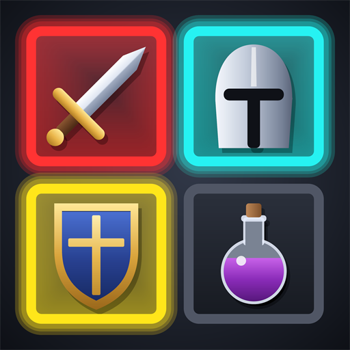

# Gear Set Colors

Never sell a piece of your gear by mistake again. Gear Set Colors marks every item in your bags that belongs to one of your equipment sets with that set's colour: your tank gear in one colour, your healing gear in another.

Made for **World of Warcraft: Forever**.

- [Features](FEATURES.md): every option, explained.
- [Changelog](CHANGELOG.md)

## Install

Install it from CurseForge (Forever flavor), or by hand:

1. Copy the `GearSetColors` folder into `World of Warcraft\_forever_\Interface\AddOns`.
2. Restart the game.

## Quick start

1. Save your equipment sets in the Equipment Manager (Character window), if you haven't yet.
2. Open your bags: the items of each set are framed and tinted in the set's colour.
3. Type `/gsc` to change a set's colour or how items are marked.

## What it does

- **Marks set items in your bags** with their set's colour: a coloured border and a coloured tint by default, or small squares in the corner, in any combination.
- **One colour per set, picked for you:** red, cyan, yellow, pink, orange... Green, blue and purple are left out, so the marks don't look like item quality borders. Change any of them with a colour picker.
- **Items in several sets** show every set's colour: the border alternates between them, and the corner squares show one per set.
- **Shared by your characters:** colours go by set name, so the same set name has the same colour everywhere.
- **In the Equipment Manager**, a colour square on each set's icon. Click it to change the colour.
- **Exact:** items are recognised by their place in your bags, as the Equipment Manager records them, so two identical rings in two sets each get the right colour.

## Commands

| Command | What it does |
|---|---|
| `/gsc` | Opens the options (also in Options > AddOns > Gear Set Colors and in the addon compartment) |

## Good to know

- **Blizzard's bags only.** Bag replacement addons (Bagnon, Baganator, ArkInventory...) draw their own bag windows, which aren't marked.
- **The bank isn't marked.**

## Reporting a bug

Open an issue, or comment on the CurseForge page, with what you did, what you expected, and any error message (BugSack shows them).

## Credits

By **Malven31**, made with Claude (Anthropic). The icon is the addon's own (`scripts/make-icon.ps1` draws it).

## Licence

MIT, see [LICENSE](LICENSE).

## Releasing

Releases are packaged and uploaded to CurseForge automatically when a version tag is pushed. The GitHub workflow `.github/workflows/release.yml` runs the [BigWigs packager](https://github.com/BigWigsMods/packager), following `.pkgmeta`.

1. Add a section for the new version at the top of `CHANGELOG.md`, for example `## 1.0.1 (2026-12-01)`, summarising for players what is new (`### New`), fixed (`### Fixed`) and changed (`### Changed`). Commit it. This section, and only this one, becomes the changelog of the file on CurseForge (website and app). A release without it is refused.
2. Run `powershell -File scripts/release.ps1 -Version 1.0.1`. It sets the version in the TOC, commits, and tags.
3. Push the branch and the tag, or add `-Push` to the command.

A tag containing `beta` or `alpha` (for example `1.1.0-beta1`) becomes a beta or alpha file on CurseForge, and any other tag a release. Every push to `main` is a dry run, and so is a run started by hand from the Actions tab: it checks that CurseForge accepts the token, builds the zip, checks its contents and attaches it to the run, without uploading anything. The TOC must have its `## X-Curse-Project-ID:` line before a tag can upload.

To build a zip locally instead, run `powershell -File scripts/package.ps1`. It writes `dist/GearSetColors-<version>.zip`, with `GearSetColors` at the root of the archive and the licence inside it, like the workflow's zip.

The icon: `powershell -File scripts/make-icon.ps1 -Out curseforge/logo.png -Size 512` (CurseForge avatar) and `-Out GearSetColors/media/icon.tga -Size 64` (in-game).
